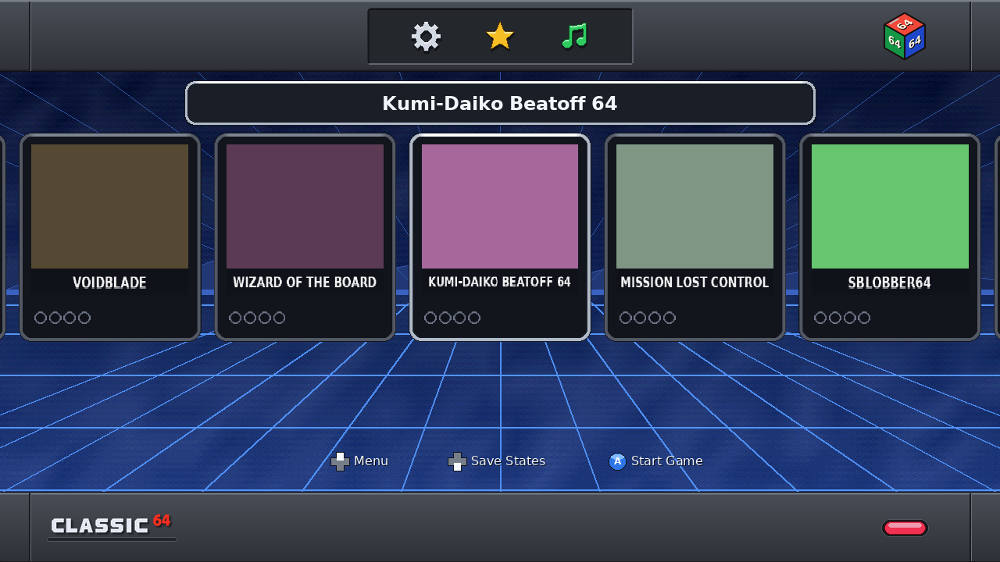
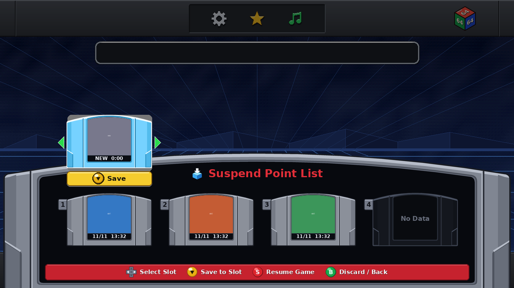

# `es-theme-n64-classic-mini` — Batocera N64 Classic Mini Theme & Appliance Suite

[](https://github.com/Ryandev/es-theme-n64-classic-mini/actions/workflows/ci.yml)

An open-source Batocera EmulationStation skin, console appliance runtime, and engine-grounded theme validator that turns a **Radxa X4** (or any `x86_64` mini PC running stock **Batocera Linux 43.1**) into a plug-and-play **64-bit Classic Mini** console—combining an authentic horizontal 5-card carousel, a 4-slot cartridge **Suspend Point List** drawer, one-button **30-Game Showcase ⇄ Full Library** switching, and seamless per-card toggling between **cycle-accurate N64 emulation** and **native decompiled/recompiled PC ports (`PORT`)**.

---

## 📦 Download Latest Build Artifacts (GitHub Actions Pipeline)

Every push to `main` runs the full verification gate ([`.github/workflows/ci.yml`](.github/workflows/ci.yml)) and publishes ready-to-install build artifacts to the **[Latest GitHub Release](https://github.com/Ryandev/es-theme-n64-classic-mini/releases/latest)**:

| Build Artifact | Direct Download Link (Latest Version) | Description |
|---|---|---|
| **`n64-classic-mini-theme.zip`** | **[⬇ Download `n64-classic-mini-theme.zip`](https://github.com/Ryandev/es-theme-n64-classic-mini/releases/latest/download/n64-classic-mini-theme.zip)** | Standalone Batocera EmulationStation theme — unzip directly into `/userdata/themes/n64-classic-mini` |
| **`n64mini-bundle.tar.gz`** | **[⬇ Download `n64mini-bundle.tar.gz`](https://github.com/Ryandev/es-theme-n64-classic-mini/releases/latest/download/n64mini-bundle.tar.gz)** | Complete console appliance bundle (theme + `n64mini.console` services + `Suspend Point List` drawer + native port recipes + RP2040 Reset/LED firmware) |
| **CI Workflow Artifacts** | **[🔗 View GitHub Actions Runs](https://github.com/Ryandev/es-theme-n64-classic-mini/actions/workflows/ci.yml)** | Per-commit build artifacts (`es-theme-n64-classic-mini-build`) from the CI pipeline |

---

## 🔗 N64 Classic Mini — Sister Repositories

This project is split across three cross-referenced repositories covering the software frontend, the 3D-printable enclosure, and the procedural background soundtrack:

| Repository | Role | Latest Build Download |
|---|---|---|
| **[`Ryandev/es-theme-n64-classic-mini`](https://github.com/Ryandev/es-theme-n64-classic-mini)** *(this repo)* | Batocera EmulationStation theme, 4-slot `Suspend Point List` drawer, native PC port installer, RP2040 firmware & C++-grounded theme validator | [`n64-classic-mini-theme.zip`](https://github.com/Ryandev/es-theme-n64-classic-mini/releases/latest/download/n64-classic-mini-theme.zip) |
| **[`Ryandev/n64-classic-mini-cad`](https://github.com/Ryandev/n64-classic-mini-cad)** | 50%-scale (`130 x 99.9 x 33.5 mm`) parametric CadQuery enclosure for the Radxa X4 with magnetic controller doors, tactile `Omron SS-5GL` Power/Reset buttons, Gmsh + CalculiX 3D FEM verification & single-plate STEP export | [`n64-classic-mini-cad-exports.zip`](https://github.com/Ryandev/n64-classic-mini-cad/releases/latest/download/n64-classic-mini-cad-exports.zip) / [`print_plate.step`](https://github.com/Ryandev/n64-classic-mini-cad/releases/latest/download/print_plate.step) |
| **[`Ryandev/n64-classic-mini-music`](https://github.com/Ryandev/n64-classic-mini-music)** | The theme's original menu music: an upbeat 32-bar loop synthesised in Python with N64-style voices | [`theme.wav`](https://github.com/Ryandev/n64-classic-mini-music/releases/latest/download/theme.wav) |

---

## Screenshots

The carousel picture is the real EmulationStation running this theme, with a game list of free
homebrew titles from the [N64brew Game Jams](https://n64brew.dev/wiki/Homebrew_Projects) on plain
placeholder cards. The Suspend Point List is drawn by the console's own compositor from sample
save slots. To regenerate both, run `uv run python tools/readme_screenshots.py` from `frontend/`
(the carousel needs the Windows engine sandbox; `--drawer-only` skips it). The script's header
explains the setup.

### Carousel
Charcoal console bars, the three top-bar options (Settings, Showcase/Full Library, background
music), the selection frame and the four suspend-point dots. Games with a native port installed
also get a `PORT` pill, and the middle top-bar button (or `F3`) switches between your full library
and the 30-game Showcase, with a short drop-down toast.



### Suspend Point List
`D-Pad Down` on the carousel opens the four-slot drawer. The physical **Reset** button
(`KEY_F13`) during a game saves a state and a screenshot, returns to the carousel and floats the
new cartridge above the slots: `C-Down` files it into a slot, `B` discards it.



### Launching a game
`A` flips the selected card, expands it to full screen and cross-fades into the boot splash
(`art/launch_splash.png`) while the emulator starts.

---

## Branding

The published theme uses generic branding: the brand text defaults to **`CLASSIC 64`**
(`DEFAULT_BRAND_TEXT` in [`frontend/src/n64mini/paths.py`](frontend/src/n64mini/paths.py)),
and all committed art is generated from code. No box art or ROMs are in git; previews use plain
colour-coded cards.

### Using your own branding on your personal build

You can swap in your own branding on your personal console in two ways—**without dirtying the git working tree**:

1. **Drop-In `local/` Folder Overrides (Automatic at Bundle / USB Stick Build Time):**
   Create a `local/` folder at the repository root (already git-ignored) and drop any of the following files into it before running `./frontend/run stick` or `./frontend/run bundle`:
   | Optional File in `local/` | Resolution | What It Replaces |
   |---|---|---|
   | `local/brand.png` | `1200 x 82` RGBA PNG | Top-bar icon & right-side 3D cube layer (`themes/n64-classic-mini/art/brand.png`) |
   | `local/console.png` | `1200 x 82` RGBA PNG | Bottom-bar left wordmark & right Power LED layer (`themes/n64-classic-mini/art/console.png`) |
   | `local/system-n64.png` | `480 x 220` RGBA PNG | System-view console badge (`themes/n64-classic-mini/art/system-n64.png`) |
   | `local/launch_splash.png` | `640 x 360` RGBA PNG | Game-launch splash frame (`themes/n64-classic-mini/art/launch_splash.png`) |
   | `local/splash.mp4` | `1920 x 1080` MP4 | Batocera boot video splash (`/userdata/splash/splash.mp4`) |

2. **Regenerate Theme Art from Custom SVGs or Brand Text via Environment Variables:**
   If you have your own `front_bezel.svg`, `n_logo.svg`, `nintendo64_logo.svg`, or `nintendo_logo.svg` in `local/svg/`, or want a custom wordmark string:
   ```bash
   cd frontend
   N64MINI_BRAND_TEXT="NINTENDO 64" \
   N64MINI_SVG_DIR="$PWD/../local/svg" \
   uv run python3 -m n64mini.theme_assets.generate --theme-dir ../themes/n64-classic-mini
   ```

---

## 🚀 Quick Start: Installing on Batocera 43.1

### Option 1: Install Theme Only (from GitHub Release Zip)
Download [`n64-classic-mini-theme.zip`](https://github.com/Ryandev/es-theme-n64-classic-mini/releases/latest/download/n64-classic-mini-theme.zip) and extract it to `/userdata/themes/n64-classic-mini` on your Batocera machine:
```bash
curl -L https://github.com/Ryandev/es-theme-n64-classic-mini/releases/latest/download/n64-classic-mini-theme.zip -o /tmp/theme.zip
unzip -o /tmp/theme.zip -d /userdata/themes/
```

### Option 2: Full Console Appliance Install (Theme + Suspend Drawer + Native PC Ports + RP2040 Reset)
1. **Make the USB installer stick.** Either unpack the release's `n64mini-bundle.tar.gz` at the
   root of a FAT-formatted USB stick (it unpacks to `n64mini-bundle/`), or build it yourself:
   ```bash
   cd frontend
   uv sync
   ./run stick /path/to/mounted/usb_stick
   ```
2. **Run One-Time Setup on the Batocera Console:**
   ```bash
   bash /media/*/n64mini-bundle/install.sh
   ```
   This installs the `n64mini` boot service, configures EmulationStation to boot directly into the 30-Game Showcase carousel, generates the bottom box-art thumbnail strip, maps the RP2040 Reset button (`KEY_F13` $\rightarrow$ `n64mini-reset`), and automatically sets up native Linux ports ([`bundle/n64mini.json`](bundle/n64mini.json)) for any matching ROMs in `/userdata/roms/n64/`.

---

## 🎮 Supported Native PC Ports Out of the Box ([`bundle/n64mini.json`](bundle/n64mini.json))

When a matching ROM dump is present in `/userdata/roms/n64/` (verified by `.z64`-order SHA-1; `.v64` and `.n64` dumps are byte-swapped automatically), `n64mini-setup` installs the native Linux port and lights up the **`PORT`** badge on that game's card (`C-Down` / `F2` toggles between **Native Port** and **Emulator**):

| Game | Native Port Project | Family | Expected `.z64` SHA-1 |
|---|---|---|---|
| **Mario Kart 64** | [SpaghettiKart](https://github.com/HarbourMasters/SpaghettiKart) `1.0.0` | HarbourMasters (`Torch` `.o2r`) | `579c48e211ae952530ffc8738709f078d5dd215e` |
| **Snowboard Kids 2** | [SnowboardKids2Recomp](https://github.com/cdlewis/snowboardkids2-recomp) `v2.0.2` | N64Recomp | `5ce896fd64276948bc2b8cccd8cd51c25a9f32aa` |
| **Banjo-Kazooie** | [BanjoRecomp](https://github.com/BanjoRecomp/BanjoRecomp) `v1.0.2` | N64Recomp | `1fe1632098865f639e22c11b9a81ee8f29c75d7a` |
| **Bomberman 64** | [BM64Recomp](https://github.com/RevoSucks/BM64Recomp) `v1.0.0` | N64Recomp | `8a7648d8105ac4fc1ad942291b2ef89aeca921c9` |
| **The Legend of Zelda: Majora's Mask** | [Zelda64Recomp](https://github.com/Zelda64Recomp/Zelda64Recomp) `v1.2.2` | N64Recomp | `d6133ace5afaa0882cf214cf88daba39e266c078` |
| **Donkey Kong 64** | [DK64Recomp](https://github.com/Rainchus/Donkey-Kong-64-Recompiled) `v1.0.3` | N64Recomp | `cf806ff2603640a748fca5026ded28802f1f4a50` |
| **Star Fox 64** | [Starfox64Recomp](https://github.com/sonicdcer/Starfox64Recomp) `1.0.3` | N64Recomp | `d8b1088520f7c5f81433292a9258c1184afa1457` |

---

## 🛠️ Development & Quality Gate

```bash
git config core.hooksPath .githooks   # enable pre-commit gate
cd frontend
uv sync                               # Python 3.12 + dev dependencies pinned in uv.lock
./run check                           # ruff, import-linter, deptry, vulture, typos, shellcheck, mypy, pyright, pytest (99.93% cov), validator, secrets
```

- **Documentation:** See [`docs/HANDOVER.md`](docs/HANDOVER.md), [`docs/ports.md`](docs/ports.md), [`docs/MFIC.md`](docs/MFIC.md), [`firmware/rp2040_reset/README.md`](firmware/rp2040_reset/README.md), and [`docs/CREDITS.md`](docs/CREDITS.md).

## Inspiration

The layout and flow (card carousel, suspend-point slots, the Reset button that drops you back to
the menu) are inspired by Nintendo's NES and SNES Classic Mini consoles. This is an independent
fan project, not affiliated with or endorsed by Nintendo.

## Licence

[MIT](LICENSE), © 2026 Ryan Powell. Third-party files keep their own licences:
the vendored EmulationStation source (`frontend/vendor/batocera-emulationstation/`, MIT), Batocera's
init scripts kept as test references (`frontend/vendor/batocera-43.1/`, LGPL-3.0-or-later, not
shipped), and the DejaVu fonts (`themes/n64-classic-mini/fonts/LICENSE-DejaVu.txt`).
